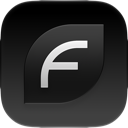
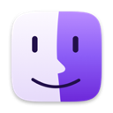
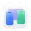

<!-- Generated by scripts/sync-translations.py; edit translations/de.json.
English source SHA-256: 7c5cb245106b099334b2c0dccf75295a9d63072042bf5c606e18ba0237ae9575
Missing translations fall back to English. -->

# Beste Mac-Apps (2026) — Native macOS-Apps

[English](README.md) · [العربية](README.ar.md) · [简体中文](README.zh-CN.md) · [日本語](README.ja.md) · [Deutsch](README.de.md)

**Du möchtest eine App hinzufügen?** [App vorschlagen](https://github.com/open-saas-directory/awesome-native-macosx-apps/issues/new?template=app-submission.md) oder lies die [Beitragsrichtlinien](CONTRIBUTING.md). Trage sie einmal in die englische README ein; die Übersetzungen aktualisieren die Maintainer mit Codex. Vorschläge sind in allen aufgeführten Sprachen willkommen.

Entdecke hochwertige macOS-Apps mit Swift, SwiftUI und AppKit: schnell, leicht und für deinen Mac entwickelt.

  
  
  

Zusammengestellt von [MacNative.io](https://macnative.io/). Entdecke weitere großartige Mac-Apps in unserem Verzeichnis.

---

## Inhalt

**Kategorien**
- 🤖 [KI-Werkzeuge](#ai-tools)
- 📊 [Analyse & Überwachung](#analytics--monitoring)
- 🎵 [Audio & Musik](#audio--music)
- 💾 [Backup & Synchronisierung](#backup--sync)
- 🌐 [Browser & Web](#browsers--web)
- 📅 [Kalender & Zeit](#calendar--time)
- 📋 [Zwischenablage-Manager](#clipboard-managers)
- 🎨 [Farbwähler](#color-pickers)
- 🗄️ [Datenbankwerkzeuge](#database-tools)
- 🖌️ [Designwerkzeuge](#design-tools)
- 👨‍💻 [Entwicklerwerkzeuge](#developer-tools)
- ✉️ [E-Mail & Kommunikation](#email--communication)
- 💰 [Finanzen](#finance)
- 🗂️ [Dateiverwaltung](#file-management)
- 🔀 [Git & Versionsverwaltung](#git--version-control)
- 🖼️ [Bilder & Grafik](#image--graphics)
- 📝 [Markdown-Editoren](#markdown-editors)
- 📌 [Menüleisten-Apps](#menu-bar-apps)
- 📡 [Netzwerkwerkzeuge](#network-tools)
- 🗒️ [Notizen & Schreiben](#note-taking--writing)
- 🔐 [Passwortmanager](#password-managers)
- 📄 [PDF-Werkzeuge](#pdf-tools)
- ⚡ [Produktivität](#productivity)
- 📸 [Screenshots & Aufnahmen](#screenshot--recording)
- 🛡️ [Sicherheit & Datenschutz](#security--privacy)
- 🛠️ [Systemwerkzeuge](#system-utilities)
- 💻 [Terminal & Shell](#terminal--shell)
- ✍️ [Texteditoren](#text-editors)
- 🎬 [Video & Medien](#video--media)
- 🌄 [Hintergrundbild-Apps](#wallpaper-apps)
- 🪟 [Fensterverwaltung](#window-management)

---

### Was macht eine App „nativ“?

Diese Liste enthält nur native Mac-Apps: mit Swift oder Objective-C auf Basis von macOS-Frameworks wie SwiftUI und AppKit entwickelt und für den Mac gestaltet.

Electron-Apps und Web-Wrapper sind nicht zugelassen. Das gilt für alle Einträge, einschließlich gesponserter Platzierungen.

---

## ⭐ Im Rampenlicht

Gesponsert von Apps im [MacNative-Pro-Tarif](https://macnative.io/pricing). Nur native Apps.

<table>
<tr>
<td width="64"></td>
<td><strong><a href="https://www.apptorium.com/sidenotes?utm_source=awesome-native-macosx-apps&utm_medium=readme&utm_campaign=featured">SideNotes</a></strong> Native macOS-Notizen am Bildschirmrand für Aufgaben, Links und Textausschnitte.</td>
</tr>
<tr>
<td width="64"></td>
<td><strong><a href="https://notchlight.com?utm_source=awesome-native-macosx-apps&utm_medium=readme&utm_campaign=featured">Notchlight</a></strong> Live-Widgets auf dem Mac-Sperrbildschirm und eine Dynamic Island an der Notch für Musik, Anrufe und Reisen.</td>
</tr>
<tr>
<td width="64"></td>
<td><strong><a href="https://www.pointbluetech.com/flowdiagram/index.html?utm_source=awesome-native-macosx-apps&utm_medium=readme&utm_campaign=featured">Flow Diagram</a></strong> Flow Diagram verwandelt unübersichtliche Fotos oder Skizzen in bearbeitbare, teilbare Diagramme.</td>
</tr>
<tr>
<td width="64"></td>
<td><strong><a href="https://fusecaptionstudio.com?utm_source=awesome-native-macosx-apps&utm_medium=readme&utm_campaign=featured">Fuse Caption Studio</a></strong> Transkribiert und übersetzt Medien in bearbeitbare Untertitel mit einer Zeitleiste wie im Videoeditor.</td>
</tr>
<tr>
<td width="64"></td>
<td><strong><a href="https://stratafiles.app?utm_source=awesome-native-macosx-apps&utm_medium=readme&utm_campaign=featured">Strata Files</a></strong> Kostenlose, quelloffene Finder-Alternative mit Sofortsuche, Ordnergrößen und Speicherplatzkarte.</td>
</tr>
<tr>
<td width="64"></td>
<td><strong><a href="https://dmgkit.app?utm_source=awesome-native-macosx-apps&utm_medium=readme&utm_campaign=featured">DMGKit</a></strong> Signiert und notarisiert Mac-Apps, heftet den Nachweis an und erstellt teilbare DMG- oder PKG-Installer.</td>
</tr>
</table>

---

## 🚀 Neu am Mac? Hier starten

Du weißt nicht, wo du anfangen sollst? Diese sechs Apps sind besonders vielseitig nützlich. Installiere sie zuerst – du wirst es dir später danken.

<table>
<tr>
<td width="64"></td>
<td><strong><a href="https://rectangleapp.com/">Rectangle</a></strong> Fenster per Tastenkürzel anordnen. Ein Werkzeug für jeden Tag.</td>
</tr>
<tr>
<td width="64"></td>
<td><strong><a href="https://github.com/p0deje/Maccy">Maccy</a></strong> Zuverlässiger Zwischenablageverlauf, damit kopierte Inhalte erhalten bleiben.</td>
</tr>
<tr>
<td width="64"></td>
<td><strong><a href="https://iina.io/">IINA</a></strong> Spielt jedes Videoformat nativ ab und lässt QuickTime einfach wirken.</td>
</tr>
<tr>
<td width="64"></td>
<td><strong><a href="https://mole.fit/">Mole</a></strong> Apps vollständig entfernen, Caches bereinigen und Speicherplatz freigeben – mit einem Werkzeug.</td>
</tr>
<tr>
<td width="64"></td>
<td><strong><a href="https://iterm2.com/">iTerm2</a></strong> Das Terminal, das macOS hätte mitbringen sollen: Tabs, geteilte Ansichten, Suche und mehr.</td>
</tr>
<tr>
<td width="64"></td>
<td><strong><a href="https://tinycast.dev/">TinyCast</a></strong> Leistungsfähiger Spotlight-Ersatz für App-Start, Zwischenablage, Skripte und mehr per Tastenkürzel.</td>
</tr>
</table>

---

## KI-Werkzeuge

[KI- und Automatisierungs-Apps auf MacNative ansehen →](https://macnative.io/categories/ai-automation?utm_source=github&utm_medium=referral&utm_campaign=native_apps_list&utm_content=category_ai-automation)

<!-- No entries yet — see CONTRIBUTING.md for how to add one. Keep entries alphabetical and native (no Electron AI wrappers). -->

<table>
</table>

## Analyse & Überwachung

<table>
<tr>
<td width="64"></td>
<td><strong><a href="https://bjango.com/mac/istatmenus/">iStat Menus</a></strong> Erweiterter Mac-Systemmonitor in der Menüleiste. <code>Kostenpflichtig</code></td>
</tr>
<tr>
<td width="64"></td>
<td><strong><a href="https://github.com/exelban/stats">Stats</a></strong> macOS-Systemmonitor für CPU, GPU, Arbeitsspeicher, Laufwerke und mehr. <code>Kostenlos</code> <code>Quelloffen</code></td>
</tr>
<tr>
<td width="64"></td>
<td><strong><a href="https://usage.pro">Usage</a></strong> Systemaktivitätsmonitor für macOS, iOS und iPadOS. <code>Grundversion kostenlos</code></td>
</tr>
</table>

## Audio & Musik

[Audio- und Sprach-Apps auf MacNative ansehen →](https://macnative.io/categories/audio-voice?utm_source=github&utm_medium=referral&utm_campaign=native_apps_list&utm_content=category_audio-voice)

<table>
<tr>
<td width="64"></td>
<td><strong><a href="https://github.com/kyleneideck/BackgroundMusic">BackgroundMusic</a></strong> macOS-Audiowerkzeug zur Lautstärkeregelung je App. <code>Kostenlos</code> <code>Quelloffen</code></td>
</tr>
<tr>
<td width="64"></td>
<td><strong><a href="https://cog.losno.co/">Cog</a></strong> Audioplayer für macOS mit breiter Formatunterstützung. <code>Kostenlos</code> <code>Quelloffen</code></td>
</tr>
<tr>
<td width="64"></td>
<td><strong><a href="https://plastic.audio/dot/">DOT</a></strong> Nimmt Mac-Audio ohne Treiber auf, mit Tonart, Tempo und Akkorden. <code>Grundversion kostenlos</code></td>
</tr>
<tr>
<td width="64"></td>
<td><strong><a href="https://eqmac.app/">eqMac</a></strong> Systemweiter Audio-Equalizer für macOS. <code>Kostenlos</code> <code>Quelloffen</code></td>
</tr>
<tr>
<td width="64"></td>
<td><strong><a href="https://iina.io/">IINA</a></strong> Moderner Videoplayer mit nativem macOS-Design. <code>Kostenlos</code> <code>Quelloffen</code></td>
</tr>
<tr>
<td width="64"></td>
<td><strong><a href="https://muxie.duhnnie.com">Muxie</a></strong> Last.fm-Scrobbler für Apple Music, Spotify Desktop, iPod Classic, Rockbox und weitere Geräte. <code>Kostenlos</code></td>
</tr>
<tr>
<td width="64"></td>
<td><strong><a href="https://github.com/kushalpandya/Petrichor">Petrichor</a></strong> Offline-Musikplayer mit über 20 Dateiformaten und vielen weiteren Funktionen. <code>Kostenlos</code> <code>Quelloffen</code></td>
</tr>
<tr>
<td width="64"></td>
<td><strong><a href="https://roamfm.app/">Roam FM</a></strong> Die Welt über internationale Radiosender entdecken. <code>Grundversion kostenlos</code></td>
</tr>
<tr>
<td width="64"></td>
<td><strong><a href="https://replay.software/sleeve">Sleeve</a></strong> Schöne Anzeige des aktuellen Titels in Apple Music. <code>Kostenpflichtig</code></td>
</tr>
<tr>
<td width="64"></td>
<td><strong><a href="https://rogueamoeba.com/soundsource/">SoundSource</a></strong> Umfassende Klangsteuerung für macOS. <code>Kostenpflichtig</code></td>
</tr>
</table>

## Backup & Synchronisierung

<table>
<tr>
<td width="64"></td>
<td><strong><a href="https://www.arqbackup.com/">Arq</a></strong> Dateien im Cloud-Speicher sichern. <code>Kostenpflichtig</code></td>
</tr>
<tr>
<td width="64"></td>
<td><strong><a href="https://bombich.com/">Carbon Copy Cloner</a></strong> Zuverlässige Backup- und Klonlösung für den Mac. <code>Kostenpflichtig</code></td>
</tr>
</table>

## Browser & Web

<table>
<tr>
<td width="64"></td>
<td><strong><a href="https://browser.kagi.com/">Orion</a></strong> Leichter WebKit-Browser ohne Telemetrie. <code>Kostenlos</code></td>
</tr>
<tr>
<td width="64"></td>
<td><strong><a href="https://zen-browser.app/">Zen Browser</a></strong> Anpassbarer Browser auf Firefox-Basis mit Fokus auf Datenschutz. <code>Kostenlos</code> <code>Quelloffen</code></td>
</tr>
</table>

## Kalender & Zeit

<table>
<tr>
<td width="64"></td>
<td><strong><a href="https://flexibits.com/fantastical">Fantastical</a></strong> Kalender-App mit Eingabe in natürlicher Sprache. <code>Abonnement</code></td>
</tr>
<tr>
<td width="64"></td>
<td><strong><a href="https://honeyday.app">Honeyday</a></strong> Geburtstage und Jahrestage aus Kontakten, mit Widgets und Erinnerungen. <code>Kostenpflichtig</code></td>
</tr>
<tr>
<td width="64"></td>
<td><strong><a href="https://horacal.app">hora Calendar</a></strong> Google-Calendar-Client für macOS mit API-Anbindung. <code>Abonnement</code></td>
</tr>
<tr>
<td width="64"></td>
<td><strong><a href="https://www.mowglii.com/itsycal/">Itsycal</a></strong> Kleiner Kalender in der Menüleiste. <code>Kostenlos</code> <code>Quelloffen</code></td>
</tr>
<tr>
<td width="64"></td>
<td><strong><a href="https://github.com/leits/MeetingBar">Meeting Bar</a></strong> Menüleisten-App für Kalendertermine. <code>Kostenlos</code> <code>Quelloffen</code></td>
</tr>
</table>

## Zwischenablage-Manager

<table>
<tr>
<td width="64"></td>
<td><strong><a href="https://github.com/p0deje/Maccy">Maccy</a></strong> Leichter Zwischenablage-Manager mit Suche. <code>Kostenlos</code> <code>Quelloffen</code></td>
</tr>
<tr>
<td width="64"></td>
<td><strong><a href="https://fiplab.com/apps/copyclip-for-mac">CopyClip</a></strong> Leichter Manager für den Zwischenablageverlauf. <code>Kostenlos</code></td>
</tr>
<tr>
<td width="64"></td>
<td><strong><a href="https://pasteapp.io/">Paste</a></strong> Schöner Zwischenablage-Manager mit Cloud-Synchronisierung. <code>Abonnement</code></td>
</tr>
<tr>
<td width="64"></td>
<td><strong><a href="https://github.com/momenbasel/pesty">Pesty</a></strong> Nativer Zwischenablage-Manager mit Pinnwänden und Einfügen per Tastatur. <code>Kostenlos</code> <code>Quelloffen</code></td>
</tr>
<tr>
<td width="64"></td>
<td><strong><a href="https://unclutterapp.com/">Unclutter</a></strong> Dateien, Notizen und Zwischenablage in einer App verwalten. <code>Kostenpflichtig</code></td>
</tr>
</table>

## Farbwähler

<table>
<tr>
<td width="64"></td>
<td><strong><a href="https://colorslurp.com/">ColorSlurp</a></strong> Erstklassiger Farbwähler und Farbmanager für macOS. <code>Grundversion kostenlos</code></td>
</tr>
<tr>
<td width="64"></td>
<td><strong><a href="https://superhighfives.com/pika">Pika</a></strong> Schöner Farbwähler für macOS. <code>Kostenlos</code> <code>Quelloffen</code></td>
</tr>
<tr>
<td width="64"></td>
<td><strong><a href="https://sipapp.io/">Sip</a></strong> Farben sammeln, ordnen und teilen. <code>Kostenpflichtig</code></td>
</tr>
</table>

## Datenbankwerkzeuge

<table>
<tr>
<td width="64"></td>
<td><strong><a href="https://eggerapps.at/postico2/">Postico</a></strong> Moderner PostgreSQL-Client für macOS. <code>Kostenpflichtig</code> <code>Team/Firma mit Sitz in der EU</code></td>
</tr>
<tr>
<td width="64"></td>
<td><strong><a href="https://tableplus.com/">TablePlus</a></strong> Modernes natives Werkzeug zur Datenbankverwaltung. <code>Grundversion kostenlos</code></td>
</tr>
<tr>
<td width="64"></td>
<td><strong><a href="https://tablepro.app">TablePro</a></strong> Nativer Datenbank-Client für MySQL, PostgreSQL, SQLite, MongoDB, Redis und mehr. <code>Kostenlos</code> <code>Quelloffen</code></td>
</tr>
</table>

## Designwerkzeuge

<table>
<tr>
<td width="64"></td>
<td><strong><a href="https://geticonjar.com/">IconJar</a></strong> Icon-Verwaltung für Designer. <code>Kostenpflichtig</code></td>
</tr>
<tr>
<td width="64"></td>
<td><strong><a href="https://www.sketch.com/">Sketch</a></strong> Professionelles digitales Design für den Mac. <code>Abonnement</code> <code>Team/Firma mit Sitz in der EU</code></td>
</tr>
<tr>
<td width="64"></td>
<td><strong><a href="https://xscopeapp.com/">xScope</a></strong> Bildschirmgrafiken messen, untersuchen und testen. <code>Kostenpflichtig</code></td>
</tr>
</table>

## Entwicklerwerkzeuge

[Entwicklertools mit Screenshots und Preisen auf MacNative ansehen →](https://macnative.io/categories/developer-tools?utm_source=github&utm_medium=referral&utm_campaign=native_apps_list&utm_content=category_developer-tools)

<table>
<tr>
<td width="64"></td>
<td><strong><a href="https://bucketmate.app/">BucketMate</a></strong> Nativer S3-Client mit grafischer Oberfläche für macOS <code>Grundversion kostenlos</code></td>
</tr>
<tr>
<td width="64"></td>
<td><strong><a href="https://github.com/CodeEditApp/CodeEdit">CodeEdit</a></strong> Nativer Codeeditor für macOS. <code>Kostenlos</code> <code>Quelloffen</code></td>
</tr>
<tr>
<td width="64"></td>
<td><strong><a href="https://github.com/vashpan/xcode-dev-cleaner">DevCleaner</a></strong> Xcode-Cache und abgeleitete Daten bereinigen. <code>Kostenlos</code> <code>Quelloffen</code></td>
</tr>
<tr>
<td width="64"></td>
<td><strong><a href="https://github.com/gitemre/device-hub-pro">Device Hub Pro</a></strong> Android-Emulatoren, Android-Handys und iOS-Simulatoren nebeneinander verwalten und spiegeln. <code>Kostenlos</code> <code>Quelloffen</code></td>
</tr>
<tr>
<td width="64"></td>
<td><strong><a href="https://devutils.com/">DevUtils</a></strong> Offline-Werkzeugkasten für Entwickler mit über 42 Werkzeugen. <code>Grundversion kostenlos</code></td>
</tr>
<tr>
<td width="64"></td>
<td><strong><a href="https://macsmith.app/">Macsmith</a></strong> Grafische Oberfläche für CLI-Entwicklertools wie Homebrew, mise, nvm, Colima und lokale Datenbanken. <code>Grundversion kostenlos</code></td>
</tr>
<tr>
<td width="64"></td>
<td><strong><a href="https://paw.cloud/">Paw</a></strong> Erweitertes API-Werkzeug für den Mac. <code>Kostenpflichtig</code></td>
</tr>
<tr>
<td width="64"></td>
<td><strong><a href="https://proxyman.io/">Proxyman</a></strong> Nativer HTTP-Debugging-Proxy. <code>Grundversion kostenlos</code></td>
</tr>
<tr>
<td width="64"></td>
<td><strong><a href="https://www.rocketsim.app/">RocketSim</a></strong> Produktiver mit dem Xcode-Simulator arbeiten. <code>Grundversion kostenlos</code></td>
</tr>
<tr>
<td width="64"></td>
<td><strong><a href="https://rockxy.io">Rockxy</a></strong> HTTP/HTTPS-Debugging-Proxy für macOS zum Aufzeichnen, Prüfen, Ändern und Wiederholen von Datenverkehr. <code>Grundversion kostenlos</code> <code>Quelloffen</code></td>
</tr>
<tr>
<td width="64"></td>
<td><strong><a href="https://snipperapp.com">SnipperApp 3</a></strong> Codeschnipsel-Manager mit iCloud- und Gist-Synchronisierung sowie integriertem MCP-Server. <code>Einmalkauf</code></td>
</tr>
<tr>
<td width="64"></td>
<td><strong><a href="https://github.com/Stmol/ssh-keys-manager-macos-app">SSH Keys Manager</a></strong> Native macOS-App zur Verwaltung von SSH-Schlüsseln und SSH-Konfigurationseinträgen. <code>Kostenlos</code> <code>Quelloffen</code></td>
</tr>
<tr>
<td width="64"></td>
<td><strong><a href="https://developer.apple.com/sf-symbols/">SF Symbols</a></strong> Apples SF Symbols durchsuchen und exportieren. <code>Kostenlos</code></td>
</tr>
<tr>
<td width="64"></td>
<td><strong><a href="https://vibedock.dev/">Vibedock</a></strong> Claude-Code-MCP-Server über die macOS-Menüleiste verwalten. <code>Einmalkauf</code></td>
</tr>
</table>

## E-Mail & Kommunikation

<table>
<tr>
<td width="64"></td>
<td><strong><a href="https://airmailapp.com/">Airmail</a></strong> Sehr schneller E-Mail-Client für den Mac. <code>Kostenpflichtig</code> <code>Team/Firma mit Sitz in der EU</code></td>
</tr>
<tr>
<td width="64"></td>
<td><strong><a href="https://freron.com/">MailMate</a></strong> Erweiterter IMAP-E-Mail-Client mit Tastatursteuerung. <code>Kostenpflichtig</code></td>
</tr>
<tr>
<td width="64"></td>
<td><strong><a href="https://mimestream.com/">Mimestream</a></strong> Nativer Gmail-Client für macOS. <code>Kostenpflichtig</code></td>
</tr>
</table>

## Finanzen

[Finanz-Apps mit Screenshots und Preisen auf MacNative ansehen →](https://macnative.io/categories/money-finance?utm_source=github&utm_medium=referral&utm_campaign=native_apps_list&utm_content=category_money-finance)

<table>
<tr>
<td width="64"></td>
<td><strong><a href="https://chronicleapp.com/">Chronicle</a></strong> Rechnungen ordnen und Zahlungen verfolgen. <code>Kostenpflichtig</code></td>
</tr>
<tr>
<td width="64"></td>
<td><strong><a href="https://www.copilot.money/">Copilot</a></strong> App für persönliche Finanzen und Budgets mit automatischer Transaktionssynchronisierung. <code>Abonnement</code></td>
</tr>
<tr>
<td width="64"></td>
<td><strong><a href="https://parendi.app">Parendi</a></strong> Importiert Kontoauszüge, kategorisiert Transaktionen und verfolgt das Nettovermögen offline. <code>Kostenpflichtig</code></td>
</tr>
<tr>
<td width="64"></td>
<td><strong><a href="https://soulver.app/">Soulver</a></strong> Intelligenter Notizblock-Rechner, der Rechenaufgaben in einfachem Englisch versteht. <code>Kostenpflichtig</code> <code>Team/Firma mit Sitz in der EU</code></td>
</tr>
<tr>
<td width="64"></td>
<td><strong><a href="https://subsday.appps.od.ua/">Subscription Day</a></strong> Bezahlte Abonnements verfolgen und Ausgabenstatistiken auswerten. <code>Grundversion kostenlos</code></td>
</tr>
</table>

## Dateiverwaltung

<table>
<tr>
<td width="64"></td>
<td><strong><a href="https://mac.eltima.com/file-manager.html">Commander One</a></strong> Dateimanager mit zwei Ansichten für macOS. <code>Grundversion kostenlos</code></td>
</tr>
<tr>
<td width="64"></td>
<td><strong><a href="https://binarynights.com/">ForkLift</a></strong> Erweiterter Dateimanager mit zwei Ansichten und FTP-Client. <code>Kostenpflichtig</code></td>
</tr>
<tr>
<td width="64"></td>
<td><strong><a href="https://www.noodlesoft.com/">Hazel</a></strong> Automatische Organisation auf dem Mac. <code>Kostenpflichtig</code></td>
</tr>
<tr>
<td width="64"></td>
<td><strong><a href="https://www.namequick.app">NameQuick</a></strong> Dateien mit KI über GPT, Gemini oder lokale Sprachmodelle umbenennen. <code>Kostenpflichtig</code></td>
</tr>
<tr>
<td width="64"></td>
<td><strong><a href="https://www.cocoatech.io/">Path Finder</a></strong> Leistungsfähige Finder-Alternative. <code>Kostenpflichtig</code></td>
</tr>
<tr>
<td width="64"></td>
<td><strong><a href="https://github.com/sindresorhus/quick-look-plugins">Quick Look plugins</a></strong> Nützliche Quick-Look-Erweiterungen für Entwickler. <code>Kostenlos</code> <code>Quelloffen</code></td>
</tr>
<tr>
<td width="64"></td>
<td><strong><a href="https://macpaw.com/encrypto">Encrypto</a></strong> Dateien mit AES-256 verschlüsseln. <code>Kostenlos</code></td>
</tr>
</table>

## Git & Versionsverwaltung

<table>
<tr>
<td width="64"></td>
<td><strong><a href="https://git-fork.com/">Fork</a></strong> Schneller und benutzerfreundlicher Git-Client für den Mac. <code>Kostenlos</code></td>
</tr>
<tr>
<td width="64"></td>
<td><strong><a href="https://www.gitfox.app/">GitFox</a></strong> Git-Client mit Fokus auf Einfachheit. <code>Kostenpflichtig</code></td>
</tr>
<tr>
<td width="64"></td>
<td><strong><a href="https://gitup.co/">GitUp</a></strong> Die Git-Oberfläche, die bisher gefehlt hat. <code>Kostenlos</code> <code>Quelloffen</code></td>
</tr>
<tr>
<td width="64"></td>
<td><strong><a href="https://www.sourcetreeapp.com/">SourceTree</a></strong> Kostenloser Git-Client von Atlassian. <code>Kostenlos</code></td>
</tr>
<tr>
<td width="64"></td>
<td><strong><a href="https://www.git-tower.com/mac">Tower</a></strong> Leistungsfähiger Git-Client für den Mac. <code>Kostenpflichtig</code> <code>Team/Firma mit Sitz in der EU</code></td>
</tr>
</table>

## Bilder & Grafik

[Foto- und Video-Apps mit Screenshots und Preisen auf MacNative ansehen →](https://macnative.io/categories/photo-video?utm_source=github&utm_medium=referral&utm_campaign=native_apps_list&utm_content=category_photo-video)

<table>
<tr>
<td width="64"></td>
<td><strong><a href="https://flyingmeat.com/acorn/">Acorn</a></strong> Voll ausgestatteter Fotoeditor, der für Menschen gestaltet wurde. <code>Kostenpflichtig</code></td>
</tr>
<tr>
<td width="64"></td>
<td><strong><a href="https://imageoptim.com/">ImageOptim</a></strong> Bilder ohne Qualitätsverlust komprimieren. <code>Kostenlos</code> <code>Quelloffen</code></td>
</tr>
<tr>
<td width="64"></td>
<td><strong><a href="https://www.pixaveapp.com/">Pixave</a></strong> Umfassender Bildorganisator und Bildbetrachter. <code>Kostenpflichtig</code></td>
</tr>
<tr>
<td width="64"></td>
<td><strong><a href="https://www.pixelmator.com/pro/">Pixelmator Pro</a></strong> Leistungsfähiger nativer Bildeditor. <code>Kostenpflichtig</code> <code>Team/Firma mit Sitz in der EU</code></td>
</tr>
<tr>
<td width="64"></td>
<td><strong><a href="https://flyingmeat.com/retrobatch/">Retrobatch</a></strong> Stapelverarbeitung von Bildern auf dem Mac. <code>Kostenpflichtig</code></td>
</tr>
<tr>
<td width="64"></td>
<td><strong><a href="https://xscopeapp.com/">xScope</a></strong> Grafiken auf dem Bildschirm messen, prüfen und testen. <code>Kostenpflichtig</code></td>
</tr>
<tr>
<td width="64"></td>
<td><strong><a href="https://zipic.app/">Zipic</a></strong> Bilder lokal komprimieren und konvertieren, mit Stapelverarbeitung und CLI. <code>Grundversion kostenlos</code></td>
</tr>
</table>

## Markdown-Editoren

<table>
<tr>
<td width="64"></td>
<td><strong><a href="https://glance.md/">Glance</a></strong> Nativer Markdown-Betrachter mit Quick-Look-Erweiterung. <code>Kostenlos</code></td>
</tr>
<tr>
<td width="64"></td>
<td><strong><a href="https://ia.net/writer">iA Writer</a></strong> Konzentrierte Schreib-App mit schöner Typografie. <code>Kostenpflichtig</code></td>
</tr>
<tr>
<td width="64"></td>
<td><strong><a href="https://macdown.uranusjr.com/">MacDown</a></strong> Quelloffener Markdown-Editor für macOS. <code>Kostenlos</code> <code>Quelloffen</code></td>
</tr>
<tr>
<td width="64"></td>
<td><strong><a href="https://marked2app.com/">Marked 2</a></strong> Markdown-Vorschau und Konvertierung. <code>Kostenpflichtig</code></td>
</tr>
<tr>
<td width="64"></td>
<td><strong><a href="https://vorojar.github.io/md-preview/">MD Preview</a></strong> Leichte Markdown-Vorschau mit Rust und nativer WebView. <code>Kostenlos</code> <code>Quelloffen</code></td>
</tr>
<tr>
<td width="64"></td>
<td><strong><a href="https://www.mweb.im/">MWeb</a></strong> Professionelles Schreiben und Notieren mit Markdown. <code>Kostenpflichtig</code></td>
</tr>
<tr>
<td width="64"></td>
<td><strong><a href="https://nicemd.app/">Nice.md</a></strong> Markdown-Betrachter mit Quick-Look-Vorschau, Gliederungsseitenleiste und optionalem Bearbeitungsmodus. <code>Grundversion kostenlos</code> <code>Team/Firma mit Sitz in der EU</code></td>
</tr>
<tr>
<td width="64"></td>
<td><strong><a href="https://typora.io/">Typora</a></strong> Minimalistischer Markdown-Editor und -Leser. <code>Kostenpflichtig</code></td>
</tr>
<tr>
<td width="64"></td>
<td><strong><a href="https://writer.computer/">Writer</a></strong> Markdown-Editor mit lokaler Datenhaltung, Rust-Backend und nativer WKWebView. <code>Kostenlos</code> <code>Quelloffen</code></td>
</tr>
</table>

## Menüleisten-Apps

<table>
<tr>
<td width="64"></td>
<td><strong><a href="https://www.macbartender.com/">Bartender</a></strong> Symbole in der Menüleiste ordnen. <code>Kostenpflichtig</code></td>
</tr>
<tr>
<td width="64"></td>
<td><strong><a href="https://commitments.pages.dev/">Commitments</a></strong> Aufgaben in der Menüleiste. <code>Kostenpflichtig</code></td>
</tr>
<tr>
<td width="64"></td>
<td><strong><a href="https://github.com/inderdhir/DatWeatherDoe">DatWeatherDoe</a></strong> Einfache Wetter-App in der Menüleiste. <code>Kostenlos</code> <code>Quelloffen</code></td>
</tr>
<tr>
<td width="64"></td>
<td><strong><a href="https://github.com/Mortennn/Dozer">Dozer</a></strong> Menüleistensymbole für einen aufgeräumten Mac ausblenden. <code>Kostenlos</code> <code>Quelloffen</code></td>
</tr>
<tr>
<td width="64"></td>
<td><strong><a href="https://www.dynamichorizon.app/">DynamicHorizon</a></strong> Zeigt Medien, Mitteilungen, Timer, Downloads und Bedienelemente rund um die Mac-Notch. <code>Kostenpflichtig</code></td>
</tr>
<tr>
<td width="64"></td>
<td><strong><a href="https://handmirror.app/">Hand Mirror</a></strong> Kamera mit einem Klick über die Menüleiste prüfen. <code>Kostenlos</code></td>
</tr>
<tr>
<td width="64"></td>
<td><strong><a href="https://github.com/patwalls/headroom">Headroom</a></strong> Claude-Code-Nutzung für Sitzung (5 Std.) und Woche (7 Tage) in der Menüleiste, aus vorhandenen lokalen Daten ohne Netzwerkanfragen. <code>Kostenlos</code> <code>Quelloffen</code></td>
</tr>
<tr>
<td width="64"></td>
<td><strong><a href="https://github.com/dwarvesf/hidden">Hidden Bar</a></strong> Menüleisteneinträge ausblenden. <code>Kostenlos</code> <code>Quelloffen</code></td>
</tr>
<tr>
<td width="64"></td>
<td><strong><a href="https://github.com/pedrovieira/Holeberry">Holeberry</a></strong> Pi-hole-Instanzen über die Menüleiste überwachen und steuern. <code>Kostenlos</code> <code>Quelloffen</code></td>
</tr>
<tr>
<td width="64"></td>
<td><strong><a href="https://homebar.pro">HomeBar for Homey Pro</a></strong> Das Homey-Pro-Smart-Home verwalten. <code>Grundversion kostenlos</code></td>
</tr>
<tr>
<td width="64"></td>
<td><strong><a href="https://www.mowglii.com/itsycal/">Itsycal</a></strong> Kleiner Kalender in der Menüleiste. <code>Kostenlos</code> <code>Quelloffen</code></td>
</tr>
<tr>
<td width="64"></td>
<td><strong><a href="https://github.com/nickustinov/itsyhome-macos">Itsyhome</a></strong> Das Smart Home in der Menüleiste. <code>Grundversion kostenlos</code> <code>Quelloffen</code></td>
</tr>
<tr>
<td width="64"></td>
<td><strong><a href="https://menubarx.app/">MenubarX</a></strong> Browser in der Menüleiste. <code>Grundversion kostenlos</code></td>
</tr>
<tr>
<td width="64"></td>
<td><strong><a href="https://sindresorhus.com/one-thing">One Thing</a></strong> Eine einzelne Aufgabe in der Menüleiste anzeigen. <code>Kostenpflichtig</code></td>
</tr>
<tr>
<td width="64"></td>
<td><strong><a href="https://github.com/larryxiao/openquack">OpenQuack</a></strong> Transkribiert 5 Minuten in 2,8 Sekunden: lokale, geräuschrobuste WhisperKit-Diktierfunktion, nativ in Swift, ca. 8 MB. <code>Kostenlos</code> <code>Quelloffen</code></td>
</tr>
<tr>
<td width="64"></td>
<td><strong><a href="https://sanebar.com">SaneBar</a></strong> Datenschutzorientierter Menüleisten-Manager zum Ausblenden und Ordnen von Symbolen. <code>Grundversion kostenlos</code></td>
</tr>
<tr>
<td width="64"></td>
<td><strong><a href="https://jazzyalex.github.io/stargazer-bar/">Stargazer Bar</a></strong> Sterne und Release-Downloads eines öffentlichen GitHub-Repositorys in der Menüleiste verfolgen. <code>Kostenlos</code> <code>Quelloffen</code></td>
</tr>
<tr>
<td width="64"></td>
<td><strong><a href="https://github.com/stonerl/Thaw">Thaw</a></strong> Leistungsfähige Menüleistenverwaltung, von Ice abgeleitet und mit geringerem Ressourcenverbrauch. <code>Kostenlos</code> <code>Quelloffen</code></td>
</tr>
<tr>
<td width="64"></td>
<td><strong><a href="https://tickerpad.app">TickerPad</a></strong> Kryptokurse in Echtzeit in der macOS-Menüleiste. <code>Grundversion kostenlos</code></td>
</tr>
<tr>
<td width="64"></td>
<td><strong><a href="https://tomatino.app">Tomatino</a></strong> Pomodoro-Timer, der Fokusmodus und Musik mit jeder Sitzung wechselt. <code>Kostenpflichtig</code></td>
</tr>
<tr>
<td width="64"></td>
<td><strong><a href="https://www.translateair.com/">TranslateAir</a></strong> KI-Übersetzung und OCR aus der Menüleiste für über 100 Sprachen. <code>Grundversion kostenlos</code></td>
</tr>
</table>

## Netzwerkwerkzeuge

<table>
<tr>
<td width="64"></td>
<td><strong><a href="https://github.com/pedrovieira/Holeberry">Holeberry</a></strong> Pi-hole-Instanzen über die Menüleiste überwachen und steuern. <code>Kostenlos</code> <code>Quelloffen</code></td>
</tr>
<tr>
<td width="64"></td>
<td><strong><a href="https://www.obdev.at/products/littlesnitch/">Little Snitch</a></strong> Netzwerkmonitor und Firewall. <code>Kostenpflichtig</code> <code>Team/Firma mit Sitz in der EU</code></td>
</tr>
<tr>
<td width="64"></td>
<td><strong><a href="https://www.obdev.at/products/microsnitch/">Micro Snitch</a></strong> Zugriffe auf Kamera und Mikrofon überwachen. <code>Kostenpflichtig</code> <code>Team/Firma mit Sitz in der EU</code></td>
</tr>
<tr>
<td width="64"></td>
<td><strong><a href="https://netnewswire.com/">NetNewsWire</a></strong> RSS-Reader für macOS. <code>Kostenlos</code> <code>Quelloffen</code></td>
</tr>
<tr>
<td width="64"></td>
<td><strong><a href="https://nssurge.com/">Surge</a></strong> Erweiterter Netzwerk-Werkzeugkasten für den Mac. <code>Kostenpflichtig</code></td>
</tr>
<tr>
<td width="64"></td>
<td><strong><a href="https://rockxy.io/tracexy">Tracexy</a></strong> Nativer macOS-Paketanalysator für laufende und gespeicherte PCAP/PCAPNG-Aufzeichnungen. <code>Kostenlos</code> <code>Quelloffen</code></td>
</tr>
<tr>
<td width="64"></td>
<td><strong><a href="https://www.intuitibits.com/products/wifi-explorer/">WiFi Explorer</a></strong> Drahtlose Netzwerke scannen, überwachen und Fehler beheben. <code>Kostenpflichtig</code></td>
</tr>
</table>

## Notizen & Schreiben

[Schreib- und Dokumenten-Apps mit Screenshots und Preisen auf MacNative ansehen →](https://macnative.io/categories/writing-documents?utm_source=github&utm_medium=referral&utm_campaign=native_apps_list&utm_content=category_writing-documents)

<table>
<tr>
<td width="64"></td>
<td><strong><a href="https://bear.app/">Bear</a></strong> Schöne und flexible Schreib-App. <code>Grundversion kostenlos</code> <code>Team/Firma mit Sitz in der EU</code></td>
</tr>
<tr>
<td width="64"></td>
<td><strong><a href="https://www.craft.do/">Craft</a></strong> Nativer Dokumenteneditor mit Freigabefunktion. <code>Grundversion kostenlos</code></td>
</tr>
<tr>
<td width="64"></td>
<td><strong><a href="https://www.devontechnologies.com/apps/devonthink">DEVONthink</a></strong> Dokumenten- und Informationsverwaltung. <code>Kostenpflichtig</code></td>
</tr>
<tr>
<td width="64"></td>
<td><strong><a href="https://github.com/alkalim/Knopo">Knopo</a></strong> Markdown-Outliner mit lokaler Datenhaltung, Rückverweisen und Abfragen. <code>Kostenlos</code> <code>Quelloffen</code></td>
</tr>
<tr>
<td width="64"></td>
<td><strong><a href="https://fsnot.es/">FSNotes</a></strong> Moderner Notizmanager für macOS. <code>Kostenlos</code> <code>Quelloffen</code></td>
</tr>
<tr>
<td width="64"></td>
<td><strong><a href="https://ia.net/writer">iA Writer</a></strong> Konzentrierte Schreib-App mit schöner Typografie. <code>Kostenpflichtig</code></td>
</tr>
<tr>
<td width="64"></td>
<td><strong><a href="http://notational.net/">Notational Velocity</a></strong> Notiz-App ohne getrennte Bedienmodi. <code>Kostenlos</code> <code>Quelloffen</code></td>
</tr>
<tr>
<td width="64"></td>
<td><strong><a href="https://www.notebooksapp.com/">Notebooks</a></strong> Informationen schreiben, ordnen und verwalten. <code>Kostenpflichtig</code></td>
</tr>
<tr>
<td width="64"></td>
<td><strong><a href="https://brettterpstra.com/projects/nvalt/">nvALT</a></strong> Abspaltung von Notational Velocity mit zusätzlichen Funktionen. <code>Kostenlos</code> <code>Quelloffen</code></td>
</tr>
<tr>
<td width="64"></td>
<td><strong><a href="https://seqlog.com/">SeqLog</a></strong> Outliner mit Markdown-Datei je Notiz, Rückverweisen und integriertem Git. <code>Kostenlos</code></td>
</tr>
<tr>
<td width="64"></td>
<td><strong><a href="https://zettelkasten.de/the-archive/">The Archive</a></strong> Notiz-App für Autoren und Forscher. <code>Kostenpflichtig</code></td>
</tr>
<tr>
<td width="64"></td>
<td><strong><a href="https://tot.rocks/">Tot</a></strong> Elegante Textsammlung in der Menüleiste. <code>Grundversion kostenlos</code></td>
</tr>
<tr>
<td width="64"></td>
<td><strong><a href="https://ulysses.app/">Ulysses</a></strong> Professionelle Schreibumgebung für den Mac. <code>Abonnement</code> <code>Team/Firma mit Sitz in der EU</code></td>
</tr>
</table>

## Passwortmanager

<table>
<tr>
<td width="64"></td>
<td><strong><a href="https://strongboxsafe.com/">Strongbox</a></strong> Nativer KeePass-Client für macOS. <code>Grundversion kostenlos</code></td>
</tr>
</table>

## PDF-Werkzeuge

<table>
<tr>
<td width="64"></td>
<td><strong><a href="https://www.pdfgear.com/">PDFgear</a></strong> Kostenloser PDF-Editor für macOS. <code>Kostenlos</code></td>
</tr>
<tr>
<td width="64"></td>
<td><strong><a href="https://pdfexpert.com/">PDF Expert</a></strong> Schneller und robuster PDF-Editor. <code>Kostenpflichtig</code></td>
</tr>
<tr>
<td width="64"></td>
<td><strong><a href="https://pdfpen.com/">PDFpenPro</a></strong> Professionelle PDF-Bearbeitung für den Mac. <code>Kostenpflichtig</code></td>
</tr>
<tr>
<td width="64"></td>
<td><strong><a href="https://skim-app.sourceforge.io/">Skim</a></strong> PDF-Leser mit Notizfunktion. <code>Kostenlos</code> <code>Quelloffen</code></td>
</tr>
</table>

## Produktivität

[Produktivitäts-Apps mit Screenshots und Preisen auf MacNative ansehen →](https://macnative.io/categories/productivity?utm_source=github&utm_medium=referral&utm_campaign=native_apps_list&utm_content=category_productivity)

<table>
<tr>
<td width="64"></td>
<td><strong><a href="https://www.alfredapp.com/">Alfred</a></strong> Produktivitäts-App für macOS mit leistungsfähigen Arbeitsabläufen. <code>Grundversion kostenlos</code></td>
</tr>
<tr>
<td width="64"></td>
<td><strong><a href="https://folivora.ai/">BetterTouchTool</a></strong> Eingabegeräte am Mac anpassen. <code>Kostenpflichtig</code> <code>Team/Firma mit Sitz in der EU</code></td>
</tr>
<tr>
<td width="64"></td>
<td><strong><a href="https://blurtblurt.com">Blurt</a></strong> Diktieren bei gedrücktem Tastenkürzel mit bereinigtem Text in jeder App über AssemblyAIs Cloud-Spracherkennung. <code>Kostenlos</code> <code>Quelloffen</code></td>
</tr>
<tr>
<td width="64"></td>
<td><strong><a href="https://www.dueapp.com/">Due</a></strong> Erinnerungen mit anhaltenden Hinweisen. <code>Kostenpflichtig</code></td>
</tr>
<tr>
<td width="64"></td>
<td><strong><a href="https://flexibits.com/fantastical">Fantastical</a></strong> Kalender-App mit Eingabe in natürlicher Sprache. <code>Abonnement</code></td>
</tr>
<tr>
<td width="64"></td>
<td><strong><a href="https://heyfocus.com/">Focus</a></strong> Ablenkende Websites und Apps blockieren. <code>Kostenpflichtig</code></td>
</tr>
<tr>
<td width="64"></td>
<td><strong><a href="https://www.keyboardmaestro.com/">Keyboard Maestro</a></strong> Apps und Websites automatisieren. <code>Kostenpflichtig</code></td>
</tr>
<tr>
<td width="64"></td>
<td><strong><a href="https://www.omnigroup.com/omnifocus/">OmniFocus</a></strong> Professionelle Aufgabenverwaltung. <code>Kostenpflichtig</code></td>
</tr>
<tr>
<td width="64"></td>
<td><strong><a href="https://www.raycast.com/">Raycast</a></strong> Sehr schneller und erweiterbarer Launcher. <code>Grundversion kostenlos</code></td>
</tr>
<tr>
<td width="64"></td>
<td><strong><a href="https://revu.cards">Revu</a></strong> Lern-App mit lokaler Datenhaltung, verteiltem Wiederholen, FSRS-Planung, Anki-Import und Lernhilfen. <code>Kostenlos</code> <code>Quelloffen</code></td>
</tr>
<tr>
<td width="64"></td>
<td><strong><a href="https://selfcontrolapp.com/">SelfControl</a></strong> Ablenkende Websites blockieren. <code>Kostenlos</code> <code>Quelloffen</code></td>
</tr>
<tr>
<td width="64"></td>
<td><strong><a href="https://snippety.app">Snippety</a></strong> Erweiterter Schnipsel-Manager für macOS und iOS. <code>Kostenpflichtig</code></td>
</tr>
<tr>
<td width="64"></td>
<td><strong><a href="https://www.taskpaper.com/">TaskPaper</a></strong> Aufgabenlisten als einfacher Text. <code>Kostenpflichtig</code></td>
</tr>
<tr>
<td width="64"></td>
<td><strong><a href="https://culturedcode.com/things/">Things</a></strong> Preisgekrönter Aufgabenmanager. <code>Kostenpflichtig</code></td>
</tr>
<tr>
<td width="64"></td>
<td><strong><a href="https://tot.rocks/">Tot</a></strong> Elegante Textsammlung in der Menüleiste. <code>Grundversion kostenlos</code></td>
</tr>
<tr>
<td width="64"></td>
<td><strong><a href="https://www.speakmac.app/">Speakmac</a></strong> Offline-Diktierfunktion für macOS per Tastenkürzel mit lokaler Transkription in jede App. <code>Einmaliges Abonnement</code></td>
</tr>
</table>

## Screenshots & Aufnahmen

<table>
<tr>
<td width="64"></td>
<td><strong><a href="https://bettercapture.app/">BetterCapture</a></strong> Leichter, intuitiver Bildschirmrekorder mit nativer Oberfläche. <code>Kostenlos</code> <code>Quelloffen</code></td>
</tr>
<tr>
<td width="64"></td>
<td><strong><a href="https://cleanshot.com/">CleanShot X</a></strong> Den Mac-Bildschirm professionell aufnehmen. <code>Kostenpflichtig</code></td>
</tr>
<tr>
<td width="64"></td>
<td><strong><a href="https://gifox.app/">Gifox</a></strong> GIFs bequem aufnehmen und teilen. <code>Kostenpflichtig</code></td>
</tr>
<tr>
<td width="64"></td>
<td><strong><a href="https://getkap.co/">Kap</a></strong> Quelloffener Bildschirmrekorder. <code>Kostenlos</code> <code>Quelloffen</code></td>
</tr>
<tr>
<td width="64"></td>
<td><strong><a href="https://keyty.app/">Keyty</a></strong> Tastatur- und Mausaktionen für Demos und Aufnahmen sichtbar machen. <code>Kostenlos</code> <code>Quelloffen</code></td>
</tr>
<tr>
<td width="64"></td>
<td><strong><a href="https://eternalstorms.at/screenfloat/">ScreenFloat</a></strong> Screenshot-Werkzeug mit schwebenden Vorschaubildern. <code>Kostenpflichtig</code> <code>Team/Firma mit Sitz in der EU</code></td>
</tr>
<tr>
<td width="64"></td>
<td><strong><a href="https://www.screenkite.com">ScreenKite</a></strong> Bildschirmaufnahme und Videoschnitt mit automatischem Zoom, viermal schneller als Screen Studio. <code>Kostenlos</code></td>
</tr>
<tr>
<td width="64"></td>
<td><strong><a href="https://shottr.cc/">Shottr</a></strong> Screenshot-Werkzeug mit erweiterten Funktionen. <code>Kostenlos</code></td>
</tr>
<tr>
<td width="64"></td>
<td><strong><a href="https://xnapper.com/">Xnapper</a></strong> Sofort schöne Screenshots erstellen. <code>Grundversion kostenlos</code></td>
</tr>
</table>

## Sicherheit & Datenschutz

[Sicherheits- und Datenschutz-Apps mit Screenshots und Preisen auf MacNative ansehen →](https://macnative.io/categories/security-privacy?utm_source=github&utm_medium=referral&utm_campaign=native_apps_list&utm_content=category_security-privacy)

<table>
<tr>
<td width="64"></td>
<td><strong><a href="https://cryptomator.org/">Cryptomator</a></strong> Plattformübergreifende Verschlüsselung auf dem Client. <code>Kostenlos</code> <code>Quelloffen</code> <code>Team/Firma mit Sitz in der EU</code></td>
</tr>
<tr>
<td width="64"></td>
<td><strong><a href="https://objective-see.org/products/knockknock.html">KnockKnock</a></strong> Dauerhaft eingerichtete Programme auf dem Mac erkennen. <code>Kostenlos</code> <code>Quelloffen</code></td>
</tr>
<tr>
<td width="64"></td>
<td><strong><a href="https://www.obdev.at/products/littlesnitch/">Little Snitch</a></strong> Netzwerkmonitor und Firewall. <code>Kostenpflichtig</code> <code>Team/Firma mit Sitz in der EU</code></td>
</tr>
<tr>
<td width="64"></td>
<td><strong><a href="https://github.com/sorkila/lockpaw">Lockpaw</a></strong> Bildschirm sperren, während Hintergrundaufgaben, Builds und KI-Agenten weiterlaufen. <code>Kostenlos</code> <code>Quelloffen</code></td>
</tr>
<tr>
<td width="64"></td>
<td><strong><a href="https://objective-see.org/products/lulu.html">Lulu</a></strong> Quelloffene Firewall für macOS. <code>Kostenlos</code> <code>Quelloffen</code></td>
</tr>
<tr>
<td width="64"></td>
<td><strong><a href="https://www.obdev.at/products/microsnitch/">Micro Snitch</a></strong> Zugriffe auf Kamera und Mikrofon überwachen. <code>Kostenpflichtig</code> <code>Team/Firma mit Sitz in der EU</code></td>
</tr>
<tr>
<td width="64"></td>
<td><strong><a href="https://objective-see.org/products/oversight.html">OverSight</a></strong> Zugriffe auf Mikrofon und Webcam überwachen. <code>Kostenlos</code> <code>Quelloffen</code></td>
</tr>
<tr>
<td width="64"></td>
<td><strong><a href="https://rockxy.io/shieldxy">Shieldxy</a></strong> Native macOS-App-Firewall zur Überwachung und Steuerung ausgehender Verbindungen je App. <code>Kostenlos</code> <code>Quelloffen</code></td>
</tr>
</table>

## Systemwerkzeuge

[Dienstprogramme mit Screenshots und Preisen auf MacNative ansehen →](https://macnative.io/categories/utilities?utm_source=github&utm_medium=referral&utm_campaign=native_apps_list&utm_content=category_utilities)

<table>
<tr>
<td width="64"></td>
<td><strong><a href="https://github.com/AppHouseKitchen/AlDente-Charge-Limiter">AlDente</a></strong> Ladebegrenzung für eine längere MacBook-Akkulebensdauer. <code>Grundversion kostenlos</code> <code>Quelloffen</code></td>
</tr>
<tr>
<td width="64"></td>
<td><strong><a href="https://freemacsoft.net/appcleaner/">AppCleaner</a></strong> Unerwünschte Apps gründlich deinstallieren. <code>Kostenlos</code></td>
</tr>
<tr>
<td width="64"></td>
<td><strong><a href="https://github.com/kyleneideck/BackgroundMusic">Background Music</a></strong> Audio je App steuern. <code>Kostenlos</code> <code>Quelloffen</code></td>
</tr>
<tr>
<td width="64"></td>
<td><strong><a href="https://www.coconut-flavour.com/coconutbattery/">coconutBattery</a></strong> Akkuzustand und -gesundheit prüfen. <code>Kostenlos</code></td>
</tr>
<tr>
<td width="64"></td>
<td><strong><a href="https://github.com/bysiber/cleardisk">ClearDisk</a></strong> macOS-Menüleistenwerkzeug zur Überwachung von über 44 Entwickler-Cachepfaden und Freigabe von Speicherplatz. <code>Kostenlos</code> <code>Quelloffen</code></td>
</tr>
<tr>
<td width="64"></td>
<td><strong><a href="https://cooldock.app/">CoolDock</a></strong> Zweites Dock für den Mac mit Live-Widgets für Musik, Kalender, Wetter und Systemstatistiken. <code>Kostenpflichtig</code> <code>Team/Firma mit Sitz in der EU</code></td>
</tr>
<tr>
<td width="64"></td>
<td><strong><a href="https://daisydiskapp.com/">DaisyDisk</a></strong> Speicherbelegung analysieren und Platz freigeben. <code>Kostenpflichtig</code></td>
</tr>
<tr>
<td width="64"></td>
<td><strong><a href="https://github.com/MonitorControl/MonitorControl">MonitorControl</a></strong> Helligkeit und Lautstärke externer Monitore wie bei eingebauten Displays steuern. <code>Kostenlos</code> <code>Quelloffen</code></td>
</tr>
<tr>
<td width="64"></td>
<td><strong><a href="https://displaybuddy.app/">DisplayBuddy</a></strong> Die tatsächliche Monitorhelligkeit direkt vom Mac aus steuern. <code>Kostenpflichtig</code></td>
</tr>
<tr>
<td width="64"></td>
<td><strong><a href="https://enduranceapp.com/">Endurance</a></strong> Die Akkulaufzeit des MacBook verlängern. <code>Kostenpflichtig</code></td>
</tr>
<tr>
<td width="64"></td>
<td><strong><a href="https://etrecheck.com/">EtreCheck</a></strong> Berichte zur Systemkonfiguration und Diagnose. <code>Kostenlos</code></td>
</tr>
<tr>
<td width="64"></td>
<td><strong><a href="https://handmirror.app/">Hand Mirror</a></strong> Kamera mit einem Klick über die Menüleiste prüfen. <code>Kostenlos</code></td>
</tr>
<tr>
<td width="64"></td>
<td><strong><a href="https://bjango.com/mac/istatmenus/">iStat Menus</a></strong> Erweiterter Mac-Systemmonitor. <code>Kostenpflichtig</code></td>
</tr>
<tr>
<td width="64"></td>
<td><strong><a href="https://linearmouse.app">LinearMouse</a></strong> Werkzeug für Maus und Trackpad auf dem Mac. <code>Kostenlos</code> <code>Quelloffen</code></td>
</tr>
<tr>
<td width="64"></td>
<td><strong><a href="https://sindresorhus.com/lungo">Lungo</a></strong> Den Ruhezustand des Mac verhindern. <code>Kostenpflichtig</code></td>
</tr>
<tr>
<td width="64"></td>
<td><strong><a href="https://mole.fit/">Mole</a></strong> Caches bereinigen, Apps verwalten, Speicherplatz analysieren und den Systemstatus überwachen. <code>Kostenpflichtig</code></td>
</tr>
<tr>
<td width="64"></td>
<td><strong><a href="https://www.titanium-software.fr/en/onyx.html">Onyx</a></strong> Vielseitiges Dienstprogramm für macOS. <code>Kostenlos</code> <code>Team/Firma mit Sitz in der EU</code></td>
</tr>
<tr>
<td width="64"></td>
<td><strong><a href="https://pearcleaner.com/">Pearcleaner</a></strong> Leistungsfähiges Werkzeug zur App-Bereinigung auf dem Mac <code>Kostenlos</code> <code>Quelloffen</code></td>
</tr>
<tr>
<td width="64"></td>
<td><strong><a href="https://rectangleapp.com/">Rectangle</a></strong> Fenster mit Tastenkürzeln verwalten. <code>Kostenlos</code> <code>Quelloffen</code></td>
</tr>
<tr>
<td width="64"></td>
<td><strong><a href="https://github.com/exelban/stats">Stats</a></strong> Systemmonitor für macOS. <code>Kostenlos</code> <code>Quelloffen</code></td>
</tr>
<tr>
<td width="64"></td>
<td><strong><a href="https://theunarchiver.com/">The Unarchiver</a></strong> Viele Archivformate entpacken. <code>Kostenlos</code></td>
</tr>
<tr>
<td width="64"></td>
<td><strong><a href="https://widgetscape.vpolabs.com">Widgetscape</a></strong> Live-Desktop-Widgets für Kalender, Wetter und Systemstatistiken mit gemeinsamem Raster und Farbpalette. <code>Grundversion kostenlos</code> <code>Team/Firma mit Sitz in der EU</code></td>
</tr>
</table>

## Terminal & Shell

<table>
<tr>
<td width="64"></td>
<td><strong><a href="https://alacritty.org/">Alacritty</a></strong> GPU-beschleunigter Terminalemulator. <code>Kostenlos</code> <code>Quelloffen</code></td>
</tr>
<tr>
<td width="64"></td>
<td><strong><a href="https://iterm2.com/">iTerm2</a></strong> Terminalemulator für macOS. <code>Kostenlos</code> <code>Quelloffen</code></td>
</tr>
<tr>
<td width="64"></td>
<td><strong><a href="https://sw.kovidgoyal.net/kitty/">Kitty</a></strong> Schnelles, funktionsreiches Terminal auf GPU-Basis. <code>Kostenlos</code> <code>Quelloffen</code></td>
</tr>
<tr>
<td width="64"></td>
<td><strong><a href="https://support.apple.com/guide/terminal/">Terminal</a></strong> In macOS integriertes Terminal. <code>Kostenlos</code></td>
</tr>
<tr>
<td width="64"></td>
<td><strong><a href="https://www.warp.dev/">Warp</a></strong> Terminal auf Rust-Basis mit modernen Funktionen. <code>Kostenlos</code></td>
</tr>
</table>

## Texteditoren

<table>
<tr>
<td width="64"></td>
<td><strong><a href="https://www.barebones.com/products/bbedit/">BBEdit</a></strong> Professioneller Text- und Codeeditor. <code>Kostenpflichtig</code></td>
</tr>
<tr>
<td width="64"></td>
<td><strong><a href="https://github.com/CodeEditApp/CodeEdit">CodeEdit</a></strong> Nativer Codeeditor für macOS. <code>Kostenlos</code> <code>Quelloffen</code></td>
</tr>
<tr>
<td width="64"></td>
<td><strong><a href="https://coteditor.com/">CotEditor</a></strong> Leichter Editor für reinen Text. <code>Kostenlos</code> <code>Quelloffen</code></td>
</tr>
<tr>
<td width="64"></td>
<td><strong><a href="https://github.com/nickustinov/itsypad-macos">Itsypad</a></strong> Kleiner, schneller Notizblock und Zwischenablage-Manager. <code>Kostenlos</code> <code>Quelloffen</code></td>
</tr>
<tr>
<td width="64"></td>
<td><strong><a href="https://macvim.org/">MacVim</a></strong> Vim-Texteditor für macOS. <code>Kostenlos</code> <code>Quelloffen</code></td>
</tr>
<tr>
<td width="64"></td>
<td><strong><a href="https://github.com/h3pdesign/Neon-Vision-Editor">Neon Vision Editor</a></strong> Leichter, moderner Codeeditor für macOS. <code>Kostenlos</code> <code>Quelloffen</code></td>
</tr>
<tr>
<td width="64"></td>
<td><strong><a href="https://nova.app/">Nova</a></strong> Schöner nativer Codeeditor von Panic. <code>Kostenpflichtig</code></td>
</tr>
<tr>
<td width="64"></td>
<td><strong><a href="https://subethaedit.net/">SubEthaEdit</a></strong> Code und Texte mit Funktionen zur Zusammenarbeit bearbeiten. <code>Kostenlos</code> <code>Quelloffen</code></td>
</tr>
<tr>
<td width="64"></td>
<td><strong><a href="https://macromates.com/">TextMate</a></strong> Leistungsfähiger Texteditor für macOS. <code>Kostenlos</code> <code>Quelloffen</code></td>
</tr>
<tr>
<td width="64"></td>
<td><strong><a href="https://github.com/qvacua/vimr">VimR</a></strong> Grafische Oberfläche für Neovim auf macOS. <code>Kostenlos</code> <code>Quelloffen</code></td>
</tr>
</table>

## Video & Medien

[Foto- und Video-Apps mit Screenshots und Preisen auf MacNative ansehen →](https://macnative.io/categories/photo-video?utm_source=github&utm_medium=referral&utm_campaign=native_apps_list&utm_content=category_photo-video)

<table>
<tr>
<td width="64"></td>
<td><strong><a href="https://handbrake.fr/">HandBrake</a></strong> Quelloffener Videotranscoder. <code>Kostenlos</code> <code>Quelloffen</code></td>
</tr>
<tr>
<td width="64"></td>
<td><strong><a href="https://iina.io/">IINA</a></strong> Moderner Mediaplayer für macOS. <code>Kostenlos</code> <code>Quelloffen</code></td>
</tr>
<tr>
<td width="64"></td>
<td><strong><a href="https://github.com/nickustinov/itsytv-macos">Itsytv</a></strong> Die fehlende Fernbedienungs-App für Apple TV. <code>Kostenlos</code> <code>Quelloffen</code></td>
</tr>
<tr>
<td width="64"></td>
<td><strong><a href="https://movistprime.com/">Movist Pro</a></strong> Leistungsfähiger Filmplayer für macOS. <code>Kostenpflichtig</code></td>
</tr>
<tr>
<td width="64"></td>
<td><strong><a href="https://software.charliemonroe.net/permute/">Permute</a></strong> Einfach bedienbarer Medienkonverter. <code>Kostenpflichtig</code></td>
</tr>
<tr>
<td width="64"></td>
<td><strong><a href="https://support.apple.com/guide/quicktime-player/">QuickTime Player</a></strong> In macOS integrierter Mediaplayer. <code>Kostenlos</code></td>
</tr>
<tr>
<td width="64"></td>
<td><strong><a href="https://subler.org/">Subler</a></strong> MP4-Dateien muxen und mit Tags versehen. <code>Kostenlos</code> <code>Quelloffen</code></td>
</tr>
<tr>
<td width="64"></td>
<td><strong><a href="https://www.videolan.org/vlc/">VLC</a></strong> Plattformübergreifender Multimediaplayer. <code>Kostenlos</code> <code>Quelloffen</code> <code>Team/Firma mit Sitz in der EU</code></td>
</tr>
</table>

## Hintergrundbild-Apps

<table>
<tr>
<td width="64"></td>
<td><strong><a href="https://www.backspacemac.app/">Backspace</a></strong> Über 1.000 Live-Hintergründe in 4K für Desktop und Sperrbildschirm. <code>Kostenpflichtig</code></td>
</tr>
<tr>
<td width="64"></td>
<td><strong><a href="https://wallspace.app/">Wallspace</a></strong> Live-Hintergründe für macOS mit anpassbarem Sperrbildschirm. <code>Grundversion kostenlos</code></td>
</tr>
</table>

## Fensterverwaltung

<table>
<tr>
<td width="64"></td>
<td><strong><a href="https://ianyh.com/amethyst/">Amethyst</a></strong> Automatischer Kachelfenstermanager. <code>Kostenlos</code> <code>Quelloffen</code></td>
</tr>
<tr>
<td width="64"></td>
<td><strong><a href="https://folivora.ai/bettersnaptool">BetterSnapTool</a></strong> Fensterverwaltung über Einrastbereiche. <code>Kostenpflichtig</code> <code>Team/Firma mit Sitz in der EU</code></td>
</tr>
<tr>
<td width="64"></td>
<td><strong><a href="https://mizage.com/divvy/">Divvy</a></strong> Fensterverwaltung auf hohem Niveau. <code>Kostenpflichtig</code></td>
</tr>
<tr>
<td width="64"></td>
<td><strong><a href="https://github.com/MrKai77/Loop">Loop</a></strong> Elegante Fensterverwaltung. <code>Kostenlos</code> <code>Quelloffen</code></td>
</tr>
<tr>
<td width="64"></td>
<td><strong><a href="https://magnet.crowdcafe.com/">Magnet</a></strong> Fenstermanager zum Einrasten von Fenstern. <code>Kostenpflichtig</code></td>
</tr>
<tr>
<td width="64"></td>
<td><strong><a href="https://manytricks.com/moom/">Moom</a></strong> Fenster einfach verschieben und vergrößern. <code>Kostenpflichtig</code></td>
</tr>
<tr>
<td width="64"></td>
<td><strong><a href="https://nudge.run">Nudge</a></strong> Kostenloser Fenstermanager mit Tastenkürzeln und Einrasten beim Ziehen an den Rand. <code>Kostenlos</code> <code>Quelloffen</code></td>
</tr>
<tr>
<td width="64"></td>
<td><strong><a href="https://rectangleapp.com/">Rectangle</a></strong> Fenster per Tastenkürzel einrasten lassen. <code>Kostenlos</code> <code>Quelloffen</code></td>
</tr>
<tr>
<td width="64"></td>
<td><strong><a href="https://rectangleapp.com/pro">Rectangle Pro</a></strong> Professionelle Fensterverwaltung. <code>Kostenpflichtig</code></td>
</tr>
<tr>
<td width="64"></td>
<td><strong><a href="https://highlyopinionated.co/swish/">Swish</a></strong> Fenster per Trackpad-Gesten steuern. <code>Kostenpflichtig</code></td>
</tr>
<tr>
<td width="64"></td>
<td><strong><a href="https://wins.cool">Wins</a></strong> Fensterverwaltungsfunktionen auf Systemebene für macOS. <code>Kostenpflichtig</code></td>
</tr>
<tr>
<td width="64"></td>
<td><strong><a href="https://github.com/koekeishiya/yabai">Yabai</a></strong> Kachelfenstermanager für macOS. <code>Kostenlos</code> <code>Quelloffen</code></td>
</tr>
</table>

## Mac-App-Ratgeber

Mehr erfahren mit den Ratgebern von MacNative:

- [So prüfst du, ob eine Mac-App Electron verwendet](https://macnative.io/blog/how-to-check-if-mac-app-uses-electron?utm_source=github&utm_medium=referral&utm_campaign=native_apps_list&utm_content=guide_electron)
- [Raycast, Tinycast, Vicinae und SuperCMD im Vergleich](https://macnative.io/blog/raycast-vs-tinycast-vs-vicinae-vs-supercmd?utm_source=github&utm_medium=referral&utm_campaign=native_apps_list&utm_content=guide_launchers)
- [Mac-Zwischenablage-Manager ohne Abonnement](https://macnative.io/blog/mac-clipboard-managers-no-subscription?utm_source=github&utm_medium=referral&utm_campaign=native_apps_list&utm_content=guide_clipboard_index)

---

## Mitwirken

Kennst du eine gute native Mac-App oder hast du einen Fehler entdeckt? Du kannst eine [App vorschlagen](https://github.com/open-saas-directory/awesome-native-macosx-apps/issues/new?template=app-submission.md), ein Issue melden oder einen Pull Request öffnen.

In [CONTRIBUTING.md](CONTRIBUTING.md) stehen die Kriterien, das Eintragsformat und die Icon-Anforderungen. Zugelassen sind nur native Mac-Apps; Electron-Apps und Web-Wrapper sind ausgeschlossen.

## Für Mac-App-Entwickler

[App bei MacNative einreichen](https://macnative.io/submit). Eine Spotlight-Platzierung in dieser README ist im kostenpflichtigen [MacNative-Pro-Tarif](https://macnative.io/pricing) enthalten. Es gelten dieselben Anforderungen an native Apps wie für alle anderen Einträge.

Du suchst weitere Plattformen für deinen App-Start? Sieh dir [Awesome Mac Launch Platforms](https://github.com/macnative/awesome-mac-launch-platforms) an.

Für eine App-Vorstellung erreichst du uns auf [X (@mac_native)](https://x.com/mac_native). Sponsoring-Anfragen bitte an [hello@macnative.io](mailto:hello@macnative.io).

## Sterne-Verlauf

Wenn dir diese Liste hilft, nützliche Apps zu finden, gib dem Repository gerne einen Stern.

## Lizenz

Soweit gesetzlich möglich, haben die Mitwirkenden auf alle Urheberrechte und verwandten Rechte an diesem Werk verzichtet.
